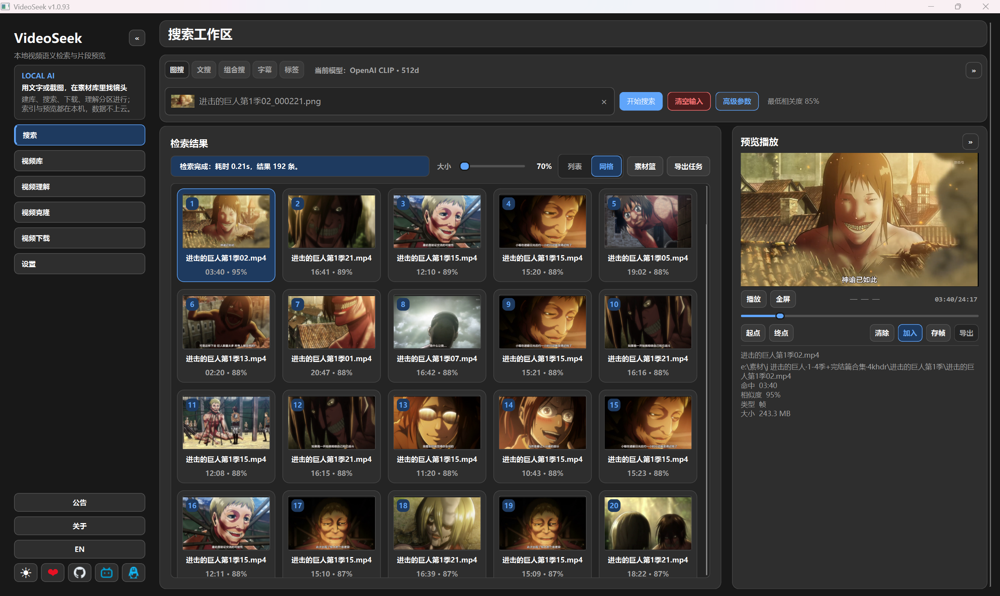

# VideoSeek

[](LICENSE)
[](https://www.lv17.top/)
[](https://github.com/6v17/VideoSeek/releases)

**中文** | [English](./README.md)

本地视频语义检索：用**文字或截图**定位镜头，支持**硬字幕 OCR**，预览后导出 MP4 / 剪映 / NLE。  
本机索引（ONNX · Lance · FFmpeg），**不上传**素材。

> **永久免费。** 勿信收费倒卖或付费代装；请从 [GitHub](https://github.com/6v17/VideoSeek) / [官网](https://www.lv17.top/) 获取。

[官网下载](https://www.lv17.top/) · [Releases](https://github.com/6v17/VideoSeek/releases) · [使用教程](https://ycnwd8tcjgtu.feishu.cn/docx/ZWkrdSqA6oJTOrxQ2XscxYtmnad) · QQ `1033551438`

<p align="center">
  
</p>

---

## Features

- **文字与图片搜索** — 自然语言或参考图找相似镜头时间段  
- **硬字幕 OCR** — 按画面字幕关键词定位台词  
- **库与范围** — 多库、指定视频、搜索预设  
- **预览与导出** — 时间轴预览；MP4；剪映草稿 / Premiere XML / 达芬奇 FCPXML  
- **本地优先** — 数据在本机；可选局域网检索、localhost Agent API  

> 可选：视频理解、标签搜索、多种 CLIP 系模型、实验性解说剪辑等。**主路径：同步 → 搜索 → 导出。**

## Use cases

| 你的情况 | 你想… |
|----------|--------|
| 大量本地 / NAS 视频 | 按画面语义找片段，而不是翻文件名 |
| 记得台词或硬字幕 | OCR 后按关键词跳到时间点 |
| 剪辑工作流 | 粗定位后进剪映 / PR / 达芬奇 |

## Quick start（安装包）

1. 从 **[lv17.top](https://www.lv17.top/)** 或 [Releases](https://github.com/6v17/VideoSeek/releases) 下载  
2. 首次启动按提示 **导入运行资源**（模型、FFmpeg；需要字幕时再导入 OCR）  
3. 侧边栏 **视频库** → 添加文件夹 → 勾选视频 → **同步选中视频**  
4. **搜索** → 输入查询 → 预览 → 导出  

## Quick start（源码）

推荐 **Windows 10/11**。其它系统见 [`docs/quickstart.md`](docs/quickstart.md)。

```bash
pip install -r requirements.txt
python main.py
```

```bash
conda env create -f environment.yml
conda activate VideoSeek
```

| 缺什么 | 怎么办 |
|--------|--------|
| 模型 / FFmpeg | 应用内导入、[123 云盘](https://1858268090.share.123pan.cn/123pan/VFA7vd-vhJXA)，或 [models release](https://github.com/6v17/VideoSeek/releases/tag/models) |
| VLC（仅 Windows 源码） | [vlc_lib release](https://github.com/6v17/VideoSeek/releases/tag/vlc_lib) → 解压到项目根目录 |

备选：模型 zip 与 `ffmpeg.exe` 已在磁盘、且不想点导入弹窗时，先关闭 VideoSeek，下载 [import_runtime_resources.py](https://raw.githubusercontent.com/6v17/VideoSeek/master/scripts/import_runtime_resources.py) 后执行（无需克隆仓库，写入 `%LOCALAPPDATA%\VideoSeek`）：

```bat
python import_runtime_resources.py openai-clip.zip ffmpeg.exe
```

## Documentation

- [使用教程（飞书）](https://ycnwd8tcjgtu.feishu.cn/docx/ZWkrdSqA6oJTOrxQ2XscxYtmnad) — 安装包图文上手  
- [`docs/quickstart.md`](docs/quickstart.md) — 源码安装与排障  
- [`docs/for-agents.md`](docs/for-agents.md) — localhost Agent API  
- [`docs/architecture.md`](docs/architecture.md) — 架构（开发者）  

## Community

- QQ 群：**1033551438**  
- [GitHub Issues](https://github.com/6v17/VideoSeek/issues) — Bug、源码构建、Agent API  

## License

[AGPL-3.0](LICENSE) © 2026 [6v17](https://github.com/6v17)

## Support

<p align="center">
  
</p>
